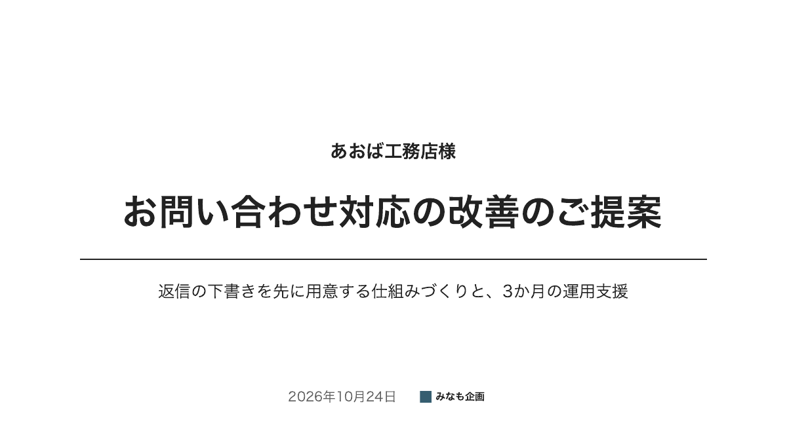
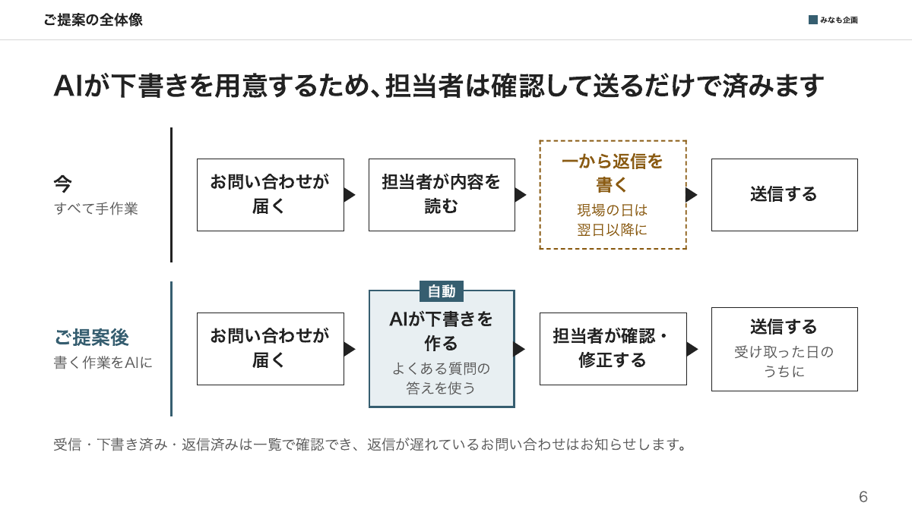
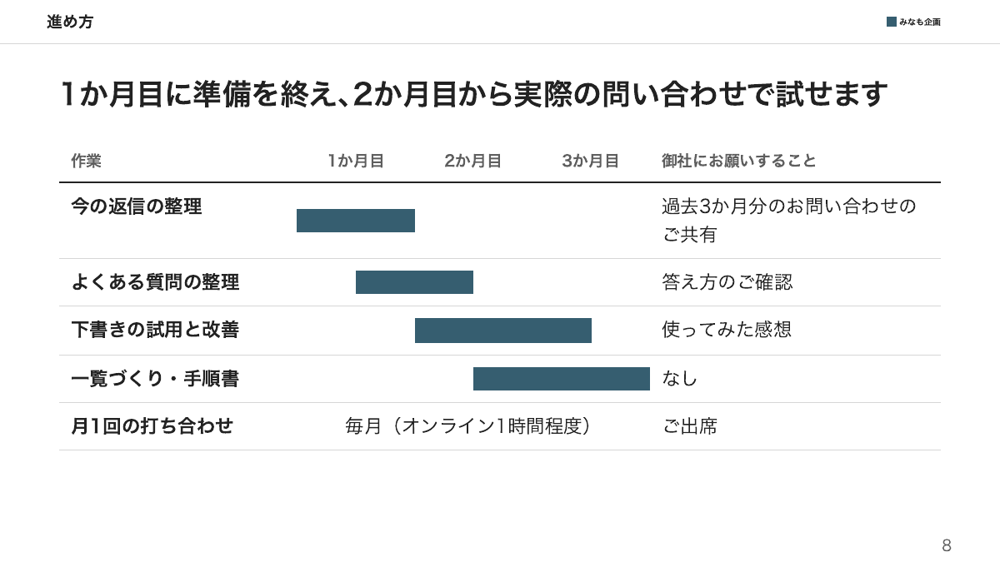
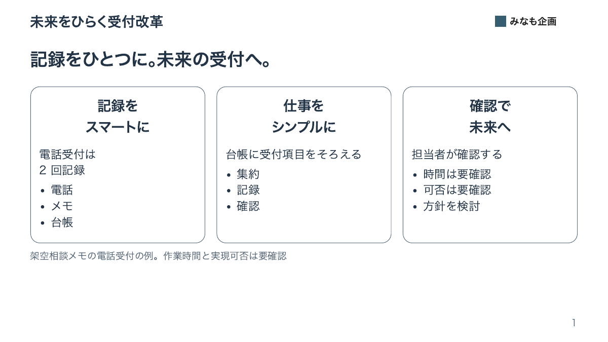
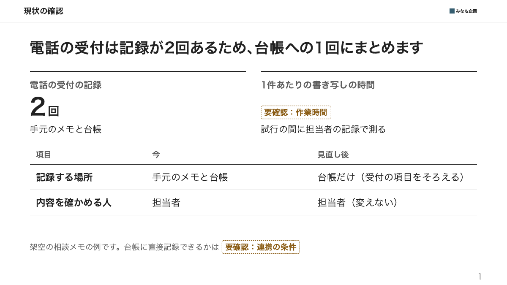

ベイジの資料とうちた氏の記事を参考にした非公式のスキルで、どちらとも関係がない。

# proposal-deck-ja

日本の会社の決裁者に出す提案書を、横向き16:9（338.67mm × 190.5mm）のPDFで作るスキルです。先に構成とメッセージの了承を得てから、決まったHTML部品に内容を入れます。会社名・案件・金額・連絡先はすべて架空の見本です。効果や品質を保証するものではありません。

## 出来上がり





12枚の[テンプレート](assets/template.html)には、番号付き要点、大きな数字、比較、原因と方針、業務の流れ、表、ガント、見積り、質問、連絡先、要確認、注記があります。文字ロゴも架空です。

## こだわりと修正前後の比較

同じ架空の電話受付の内容を、[修正前](examples/before.html)と[修正後](examples/after.html)の各1枚で比べています。修正前は比較のために意図して作った例で、モデルが自動生成した結果の採集ではありません。

| 修正前 | 修正後 |
| --- | --- |
|  |  |

| 決まり | 修正前 | 修正後 |
| --- | --- | --- |
| 情報の関係で組む | 角丸カードを3つ並べる | 大きな数字と、今と見直し後を比べる表で示す |
| 項目数をそろえない | 3カードそれぞれに3項目 | 必要な内容だけ残し、同じ説明の重複を省く |
| 普通のタイトル | 「未来をひらく受付改革」 | 「現状の確認」 |
| 事実と判断を1文に | 「記録をひとつに。未来の受付へ。」 | 「電話の受付は記録が2回あるため、台帳への1回にまとめます」 |
| 文節で改行 | 見出しの途中で手動改行 | 不要な改行を除き、文節による折り返しを指定 |
| 数字の前後を空けない | 「2 回」 | 「2回」。金額は右寄せ・桁のそろう数字を指定 |
| 未確認を区別する | カード内の文章に混在 | 「要確認：作業時間」のように破線の枠と文字で表示 |

そのほか、色は白のほか3色、OS標準のゴシック体、28/22/20/18/15ptの文字階層、共通位置のタイトル・ロゴ・番号を使います。詳しい理由と色の差の値は[デザインの決まり](references/design.md)にまとめています。

## 入れ方

このフォルダーを、使うAIエージェントのスキル用フォルダーにコピーします。同名フォルダーがある場合は、上書き前に内容を確認してください。CLIで選んで入れる場合は次のとおりです（この導入操作はネットワークに接続します）。

```bash
npx skills add hirosta/skills --skill proposal-deck-ja
```

このスキル自身にPythonの追加依存はありません。フォルダー内のファイルだけで使えます。

## 必要なもの

- Python 3.9以上
- ローカルにあるChrome・Chromium・Microsoft Edgeのいずれか
- Macのヒラギノ、Windowsのメイリオ、LinuxのNoto Sans JP。入っていない場合は利用者が用意する必要があります。スキルはフォントを取得しません
- 全ページを見直せるPDFビューアー。画像化して確認するなら既存の `pdftoppm` などを別途使用します（PDF出力スクリプトの依存ではありません）

## 使い方

「proposal-deck-jaで、相談メモから提案書を作ってください」と依頼します。提案先、相談内容、提案内容、期間、金額、掲載許可済みの実績や担当者を渡してください。不足する事実は「要確認」で残します。

全ページのタイトルとメッセージの一覧を確認し、了承したら、出力先を伝えます。HTMLとSVGロゴを同じ場所に置き、先頭のCSS変数で提案先・件名・日付・色・フォントを変更します。ロゴは許可を得た自己完結したSVGへ差し替えられます。既存ファイルの上書きには確認が必要です。

スキルのフォルダーを基準に、次のコマンドで点検・出力します。

```bash
python3 scripts/check_messages.py <出力先>/proposal.html
python3 scripts/build_pdf.py <出力先>/proposal.html --out <出力先>/proposal.pdf
```

`--out` を省くとHTMLと同じ場所・同じ名前のPDFを作ります。同名PDFは `--force` を指定しない限り上書きしません。自動検出できないブラウザは `--browser <実行ファイル>` で指定します。

印刷スクリプトは入力を読み、隔離した一時フォルダーと一時プロファイルを使ってPDFを出力し、後片付けします。スクリプト、外部CSS、CSSのURL・import、埋め込み、HTMLと別フォルダーの画像などは拒否します。対応画像は追加参照・処理のないSVGのみです。CSPで処理と外部素材の読込を制限し、ブラウザにはバックグラウンド通信の抑制・名前解決の遮断・到達しないローカルプロキシを指定します。既存のブラウザプロファイルは使いません。ブラウザをOSレベルでネットワーク隔離する機能ではありません。

## 試した結果

条件：架空相談メモ1件、テンプレート12枚、修正前後各1枚、作成例12枚。初版はGPT-6（Codex）で作り、テンプレートの組みと作成例の文面はClaude Opus 5.5で直しました。素材はすべて同梱しています。

- [相談メモ](examples/consultation.md)から[タイトルとメッセージの一覧](examples/story.md)を作り、同じ部品で[提案書作成例](examples/proposal.html)を作成しました。先頭の提案先・件名を差し替え、旧提案先名・旧件名の残存がないことを検索しました
- 構成と出力先の了承は、相談メモに明記した演習上の条件です。実際の利用者との了承取得の対話は検証していません
- `build_pdf.py` でテンプレートと作成例がそれぞれ12ページ、修正前後が各1ページになることを確認しました。ヘッダー・フッターは付かず、PDFの全ページを画像化して文字切れ・はみ出し・改行を確認しました
- メッセージ点検では、修正前に句点・二段構えを表示し、修正後には機械的な指摘がありませんでした。これは文章の正しさや提案の効果の判定ではありません
- 本文の根拠とメッセージを一覧で照合し、2ページ目で予告した判断事項を、最後のページで同じ番号で回収しました。文末だけでなく、隣接するメッセージの文型も目で確認しました
- 相談メモにない数字・会議・実績を足していないかを、ページごとに確認しました
- 構文・字下げ確認、上書き拒否、既定出力先、ブラウザ明示指定と未検出時の案内、ページ数不一致時の保存拒否、外部参照の拒否、色の差の計算、差分の空白確認を行いました。自動テスト・テストスイートは作っていません

### 作成例のストーリー一覧

| ページ | タイトル | メッセージ | 前のページとのつながり | 本文の根拠 |
| --- | --- | --- | --- | --- |
| 1 | 表紙 | なし | なし | 提案先・件名・副題・日付 |
| 2 | ご提案の要点 | 受付の項目と記録先をそろえ、4週間の試行で効果を確かめます | 結論 | 提案すること・期間・概算予算、判断事項の予告 |
| 3 | 現状の確認 | メールも電話も、最後は担当者が台帳に書き写しています | なぜなら | メールと電話の受付の流れ |
| 4 | 現状の確認 | 電話の受注は2回記録し、確かめる項目も担当者ごとに違います | さらに | 電話のメモと台帳、確認項目の違い |
| 5 | 課題の整理 | 書き写す回数と、担当者ごとの確認の違いを減らすことが課題です | だから | 今起きていること→方針 |
| 6 | ご提案の全体像 | 連携できれば、受付で一度記録するだけで台帳にも残せます | そこで | 今と提案後の業務の流れ |
| 7 | ご提案の内容 | 手順の整理と連携の確認を分けて進め、使える部分から試します | なぜなら連携の条件が未確認 | 行うことと変わること |
| 8 | 進め方 | 初週に対象を決め、3週目には範囲を限って試行に入れます | 具体的には | 4週間の工程 |
| 9 | お見積り | 4週間の試行は概算80万円（税別）で、本稼働の費用は含みません | その費用は | 内訳30万円と50万円、対象外 |
| 10 | 会社紹介 | 窓口と業務整理の担当を分け、試行の最後まで同じ体制で進めます | 進める体制は | 体制案の2つの役割 |
| 11 | よくあるご質問 | 本稼働に進むかは、試行の結果を見てから決められます | 気になる点は | 本稼働・連携・追加費用 |
| 12 | 今後の進め方 | 試行に進むと決まれば、開始日と体制をご相談して準備に入ります | 最後に | 2ページ目と同じ番号の判断事項 |

残った「要確認」：受付件数、作業時間と差し戻しの実測、台帳の連携条件、開始日と参加者、実績・担当者の掲載許可、税額・支払条件・見積有効期限、正式な連絡先。演習には確認担当の実在人物を設定せず、利用時に提案窓口と利用者が確認する項目として残しています。

## 分かっていないこと・制約

- Windowsのメイリオでの見た目は未確認です
- LinuxのNoto Sans JPでの見た目は未確認です
- 出力PDFはPowerPointで編集できるスライドファイルではありません
- 画面幅に応じた縮小はCSSで指定していますが、各幅での実画面の確認は未実施です
- ブラウザ・フォントによる禁則、文節改行、自動空き、等幅数字の差があります。利用環境で全ページを確認してください
- 高さ固定で中身のはみ出しを隠すため、12ページになっても文字が欠けていないとは判断できません
- PDFページ数はChrome系が出力する `/Type /Page` の個数で照合します。汎用PDF解析器ではなく、形式が変わって数えられない場合は保存せず終了します
- メッセージ点検は表現候補を表示するだけです。判断や事実の真偽、異なる言葉での文型の繰り返しは人が確認します
- 価格・期間は説明用の架空条件であり、利用時の見積りや成果を保証しません

## 着想元

- ベイジ／枌谷力『最強の提案書を作る方法～伝わるストーリー・コピー・デザインの法則』（2020年）。[スライド](https://speakerdeck.com/sogitani1107/zui-qiang-falseti-an-shu-wozuo-rufang-fa-chuan-warusutorikopidezainfalsefa-ze)、[解説記事](https://baigie.me/officialblog/2020/05/27/making_presentation_sheet/)。参照日：2026-10-22。構成の順序と、装飾より色・文字階層・整列・余白を重視する考え方を参考にしました
- うちた「AIで資料作成を終わらす。コンサル品質を求めて辿り着いた究極プロンプト×見本61枚」（note、2026年9月）。[記事](https://note.com/uchita_success/n/na5babdc58b0e)。参照日：2026-10-24。メッセージの文の形、縦読みでの論理確認、判断事項の予告と回収の考え方を参考にしました

いずれも考え方だけを参考にし、文章・図・デザイン・プロンプトは写していません。著者や組織の監修・推奨を受けたものではありません。

## ライセンス

このスキルの文章・HTML・SVG・スクリプト・架空素材・PNGは[MIT](LICENSE)です。着想元の資料・記事にこのライセンスを適用するものではありません。
